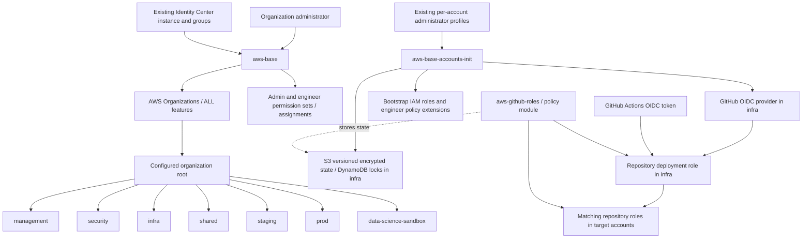

# AWS Multi-Account Platform

A Terraform-based AWS account foundation with AWS Organizations, IAM Identity Center
permission sets, GitHub OIDC federation, cross-account deployment roles and a shared
Terraform state backend. The implementation keeps three independent root stacks
and a reusable IAM policy attachment module.

The configuration uses standard Terraform HCL. Its existing lockfiles use the
OpenTofu registry, so the documented validation toolchain is **OpenTofu 1.11.5**.
The locked AWS provider versions are preserved without upgrades.

## Architecture



The diagram reflects the declared account labels. All seven account resources use
`var.root_id`; there is no OU hierarchy. A resource named `management` does not by
itself establish which AWS account is the organization's actual management/payer
account. Confirm the caller, existing account identities and import mapping before
planning. Do not create another account solely to match that label.

## Repository structure

```text
aws-multi-account-platform/
|-- aws-base/                         # Organization, accounts, SSO and cost controls
|   |-- *.tf
|   |-- .terraform.lock.hcl
|   `-- terraform.tfvars.example
|-- aws-base-accounts-init/           # Account profiles, OIDC, state and bootstrap roles
|   |-- *.tf
|   |-- .terraform.lock.hcl
|   `-- terraform.tfvars.example
|-- aws-github-roles/                 # Repository role chains and service permissions
|   |-- *.tf
|   |-- .terraform.lock.hcl
|   |-- terraform.tfvars.example
|   |-- backend.hcl.example
|   `-- modules/attach_iam_policies/
|-- scripts/validate.py
|-- .github/workflows/validate.yml
|-- .github/dependabot.yml
|-- .gitignore
|-- docs/PROVENANCE.md
|-- docs/VALIDATION.md
`-- README.md
```

## Stack responsibilities and account structure

| Stack | What it manages | State | Locked AWS provider |
| --- | --- | --- | --- |
| `aws-base` | Organization, seven account resources, group assignments, permission sets, cost monitoring | Local | 5.70.0 |
| `aws-base-accounts-init` | GitHub OIDC, bootstrap deployment roles, state bucket/lock table, permission-set extensions and selected service-linked roles | Local | 5.98.0 |
| `aws-github-roles` | Per-repository infra and target-account IAM roles and service policies | S3 | 6.35.1 |

The account labels are `management`, `security`, `infra`, `shared`, `staging`,
`prod` and `data-science-sandbox`. Each account resource configures
`close_on_deletion = true`, which is retained from the implementation. Removing
accounts from configuration can request account closure; examine destructive plans
carefully. The state bucket separately has `prevent_destroy = true`.

The stacks do not read each other's Terraform state. Account IDs, profile names,
repository names and backend settings are explicit inputs that must agree across
stacks. There are no Control Tower or Account Factory resources.

## AWS Organizations and SCPs

`aws-base/organization.tf` enables `feature_set = "ALL"` and trusted access for:

- IAM Identity Center: `sso.amazonaws.com`.
- Account Management: `account.amazonaws.com`.
- Cost Optimization Hub: `cost-optimization-hub.bcm.amazonaws.com`.
- IAM: `iam.amazonaws.com`.
- CloudTrail: `cloudtrail.amazonaws.com`.
- GuardDuty: `guardduty.amazonaws.com`.
- Security Hub: `securityhub.amazonaws.com`.

**SCPs are not implemented.** There are no `aws_organizations_policy`, policy
attachment, OU or delegated-administrator resources. IAM permissions for the
Organizations API in the policy module do not constitute SCP guardrails. Existing
organization policies, if any, are outside this repository's management scope.

Trusted access allows integration with Organizations; it is distinct from
configuring a security service. See
[AWS trusted-access documentation](https://docs.aws.amazon.com/organizations/latest/userguide/orgs_integrate_services.html).

## IAM and IAM Identity Center

The configuration discovers an existing Identity Center instance and uses the
first instance returned. It looks up existing groups by `DisplayName`; it does not
create the instance, users, groups, identity-provider federation or SCIM settings.
Run in the Identity Center home region and ensure the lookup account has access
to the intended organization instance. The bootstrap stack performs its Identity
Center lookups through the `management` provider alias.

For every account label the base stack creates two permission sets with eight-hour
sessions:

- **Admin:** AWS-managed `AdministratorAccess` and `job-function/Billing`.
- **Engineer:** AWS-managed `ReadOnlyAccess`.

Group lists control account assignments. If the same group receives both sets,
its members can choose the administrator set; engineer assignment does not reduce
that access.

The bootstrap stack adds customer-managed policy references to the existing
`staging-engineer` and `prod-engineer` permission sets:

- Staging: Kafka data-plane/topic/group actions and two GuardDuty malware-scan actions.
- Production: an explicit deny on SSM parameter reads/descriptions.

These are IAM/SSO policy extensions, not SCPs. The production deny is not a blanket
block on Secrets Manager or every source of sensitive data. Spot service-linked
roles are created only in staging, production and the data-science sandbox.

## GitHub OIDC and cross-account roles

The bootstrap stack creates the GitHub OIDC provider **only in the infra account**,
with the STS audience and the original two thumbprints. It grants the management
repository a bootstrap infra role and six target-account roles. Bootstrap roles
have broad `iam:*` access, plus state and assume-role permissions where defined.

The roles stack then creates infra roles keyed by `infra_github_repos_config`.
Each target account has its own repository configuration map. Every repository
key used by a target must also be present in the infra map. Keys are actual GitHub
repository names and become role/policy names.

The OIDC subject patterns are retained: repository environments, pull requests,
main/hotfix branches, version-tag patterns and optional `repo_branches`. The
bootstrap role additionally permits master and has its own subject list. Custom
`repo_branches` entries are appended directly as complete subject patterns; they
are not expanded from short branch names.

Target trust policies name the **infra role session ARN ending in `GitHubActions`**.
The initial OIDC session name must therefore be `GitHubActions`. Arbitrary local
admin sessions or a different role session name do not satisfy the same trust
policy. The per-repository chain supports `sts:AssumeRole` and `sts:TagSession`;
bootstrap role trust uses the narrower original `sts:AssumeRole` action.

Review the existing pull-request/environment subject patterns and broad IAM grants
before authorizing external contributors. The validation CI included here has no
OIDC permission, AWS role configuration or deployment job.

### Policy attachment module

`aws-github-roles/modules/attach_iam_policies` retains the complete permission
catalog from the source. Selection is through each repository's `permissions`
list; accepted values are enforced by the module's variable validation. Options
cover IAM, state access, compute, storage, networking, messaging, data services,
observability and security APIs. All original policy files remain available.

Most grants are service-wide and several use wildcard resources. Some delete
operations are tag-conditioned; this is not a uniformly least-privilege module.
The `readOnly` option attaches AWS ReadOnlyAccess plus two additional list-tag
permissions. The `terraform` option grants access to the bucket and lock-table
names derived from `terraform_state_prefix`; match the bootstrap prefix exactly.
Selecting `guardduty`, `securityhub`, `inspector2` or `cloudtrail` grants IAM
permissions but does not create those services.

## Security and cost integrations

| Capability | Implemented scope |
| --- | --- |
| Organizations security integration | Trusted-access principal registration for CloudTrail, GuardDuty and Security Hub |
| Security deployment permissions | Optional IAM policies for CloudTrail, GuardDuty, Security Hub, Inspector and other services |
| Detection/logging infrastructure | No detectors, trails, log archive account, aggregation, findings routing, Security Hub standards or delegated security administrators |
| State protection | Infra S3 bucket with versioning, AES256 server-side encryption, public-access blocking and deletion prevention; on-demand DynamoDB lock table |
| Monthly budget | Configurable USD limit; actual notifications at 85%/100% and forecast notification at 100% |
| Cost anomaly detection | SERVICE monitor, daily email subscription, absolute impact >=100 and percentage impact >=40 thresholds |
| Cost Optimization Hub | Enrollment includes member accounts |

Budget alerts and anomaly email delivery require valid operator-controlled
addresses and service-side setup/confirmation where applicable. The cost settings
do not implement automated spending limits. The two bootstrap roots keep local
state; the S3 bucket does not automatically migrate them. Protect and back up their
local state, which can contain account and policy details.

## Prerequisites

- OpenTofu 1.11.5, Python 3, and network access to download locked AWS providers.
- AWS CLI credentials for organization administration and the seven bootstrap
  provider profiles. The examples contain fictitious IDs and documentation domains.
- Existing or deliberately adopted AWS organization/root and Identity Center
  instance/groups. This repository does not bootstrap an external identity source.
- Unique account email addresses under a domain you control, and a globally unique
  Terraform state bucket prefix.
- Appropriate IAM permissions for account creation/adoption, SSO administration,
  OIDC, roles/policies, cost services and state-resource creation.

The source accepts `root_id` externally while declaring an organization resource.
A completely blank-account, one-command organization/SSO bootstrap is not
implemented. Establish the organization/root and identity prerequisites, then
import existing resources into the correct stack rather than recreating them.

## Configuration

Copy examples to local, ignored files:

```sh
for stack in aws-base aws-base-accounts-init aws-github-roles; do
  cp "$stack/terraform.tfvars.example" "$stack/terraform.tfvars"
done
cp aws-github-roles/backend.hcl.example aws-github-roles/backend.hcl
```

| Location | Required customization |
| --- | --- |
| `aws-base/terraform.tfvars` | Organization root, account email domain, group DisplayNames, home region, budget/notification settings |
| `aws-base-accounts-init/terraform.tfvars` | Actual GitHub organization/repository, unique state prefix, profile mapping for every alias |
| `aws-github-roles/terraform.tfvars` | Actual target account IDs, same bootstrap repository/state prefix, repository-to-permission maps |
| `aws-github-roles/backend.hcl` | Existing state bucket, lock table, region and this stack's unique state key |

The example role maps use one fictional infrastructure repository and read-only
target permissions. They replace the private repository inventory; they are not
a statement of your deployment's required permissions. Choose the required
permissions from the retained module catalog. Example IDs `111111111111` through
`666666666666` and `example.com` must not be used for deployment.

## Deployment workflow

The commands below are operator instructions, not operations performed during
preparation. Review identities and plans before any deployment. Never point these
stacks at existing resources without an import/state-ownership decision.

### 1. Validate without AWS access

```sh
python3 scripts/validate.py
# One stack only:
python3 scripts/validate.py aws-github-roles
```

The script copies configurations into temporary directories, checks formatting
and example HCL syntax, and runs `tofu init -backend=false -lockfile=readonly` plus
`tofu validate`. It strips AWS credentials and variable overrides from the process
environment and uses empty AWS configuration paths. It never runs plan/apply or
initializes a live state backend. Provider downloads require internet access.
[OpenTofu validate](https://opentofu.org/docs/cli/commands/validate/) does not
perform provider API or remote-state checks. Input identities and effective IAM
permissions still require a real deployment plan and runtime verification.

### 2. Organization, accounts and Identity Center assignments

Use organization-administrator credentials in the intended Identity Center region:

```sh
export AWS_PROFILE=example-organization-admin
tofu -chdir=aws-base init
tofu -chdir=aws-base plan -var-file=terraform.tfvars -out=reviewed.tfplan
```

For an existing organization, import its organization resource and existing
account/SSO resources as appropriate before a full plan. Account resources must
map to the real intended accounts, including the account labeled `management`.
For a new organization, resolve the externally supplied root/identity prerequisites
first. Review account creation, root placement, assignment and cost changes.
After an authorized deployment, retain this stack's local state securely.

### 3. Bootstrap account access and state resources

Authenticate each profile in `account_profiles`, ensuring the `management` alias
can query the intended Identity Center instance:

```sh
tofu -chdir=aws-base-accounts-init init
tofu -chdir=aws-base-accounts-init plan -var-file=terraform.tfvars -out=reviewed.tfplan
```

After an authorized deployment, the state bucket/lock table, OIDC provider and
bootstrap roles must exist before the final stack is initialized. This root also
keeps local state. Do not destroy or discard it after creating the backend.

### 4. Repository deployment roles

Obtain infra bootstrap-role credentials using GitHub OIDC with the configured
repository/subject and session name `GitHubActions`. Supply those short-lived
credentials through your deployment runner's standard AWS credential chain:

```sh
tofu -chdir=aws-github-roles init -backend-config=backend.hcl
tofu -chdir=aws-github-roles plan -var-file=terraform.tfvars -out=reviewed.tfplan
```

Provider aliases assume the target bootstrap roles while the infra provider and
S3 backend use the infra credentials. Review role trust and selected policies.
Each stack's reviewed plan can be applied by your authorized deployment process;
this repository deliberately supplies no automated apply workflow. Keep saved
plans out of Git. Do not apply the example inputs without replacing them.

The source backend is DynamoDB-locked S3, and the first two roots are local. No
state migration, locking redesign or backend replacement was introduced.

## Validation and CI

`.github/workflows/validate.yml` follows the existing project workflow style:
manual dispatch, PRs/pushes on `main`, ARM runners, named steps and separate jobs.
It validates all three roots independently using their existing provider locks.
Gitleaks scans current files and complete fetched Git history with redacted output.
Dependabot checks GitHub Actions weekly.

CI requires no AWS credentials, private reusable workflows or Terraform backend
access. It is configuration validation and secret detection, not a live account
plan, security certification or deployment. See [validation results](docs/VALIDATION.md).

## Troubleshooting

| Symptom | What to check |
| --- | --- |
| Provider lock mismatch | Use the documented OpenTofu toolchain; locks use `registry.opentofu.org`, not Terraform's default provider registry |
| Init cannot download provider | Registry/release connectivity, proxy, disk space and lock checksums; do not upgrade merely to bypass a download problem |
| `root_id` or account placement mismatch | Actual organization/root and caller identity; the variable is not automatically derived from the organization resource |
| SSO instance list empty or group not found | Identity Center home region, lookup account/alias, existing group DisplayNames and caller permissions |
| Permission-set policy cannot provision | The referenced customer-managed staging/prod policy must exist in the target account with the same name/path |
| Local bootstrap profile missing | Every key in `account_profiles` must match the seven original provider aliases and an authenticated local profile |
| Cross-account `AccessDenied` | Account IDs, bootstrap role name/path, source repo OIDC subject, exact `GitHubActions` source session and both sides of assume-role permissions |
| Missing repository key | Add the same repository key to the infra map before referencing it in a target map |
| State access or lock failure | Infra credentials, bucket/table prefix, backend key/region and state IAM policy; investigate lock ownership before any unlock |
| Security service appears disabled | Trusted access and IAM grants do not deploy detectors, trails, standards or delegated administrators |
| Terraform proposes account/role recreation | Wrong state/root, unimported existing resources or changed identity inputs; stop and reconcile ownership before proceeding |
| Budget notification missing | Real email, notification configuration, billing scope and AWS-side delivery requirements |

## Limitations and publication

All original service policies and trust conditions are retained, including broad
wildcards and administrative permissions. These should be reviewed for your
threat model; sanitization does not harden authorization. No new SCPs, OUs,
networking, logging/security deployments or account-vending features were added.
Local validation does not establish that account creation, IAM session principals,
Identity Center provisioning, backend access or service APIs work in your AWS estate.

[Publication and provenance notes](docs/PROVENANCE.md) flag the extracted code
whose publication rights are unconfirmed. No license grant is asserted. No source
state, private tfvars, credentials, corporate workflow or source Git history is
included. The destination's existing Git metadata is retained; its history needs
separate review before publication.
